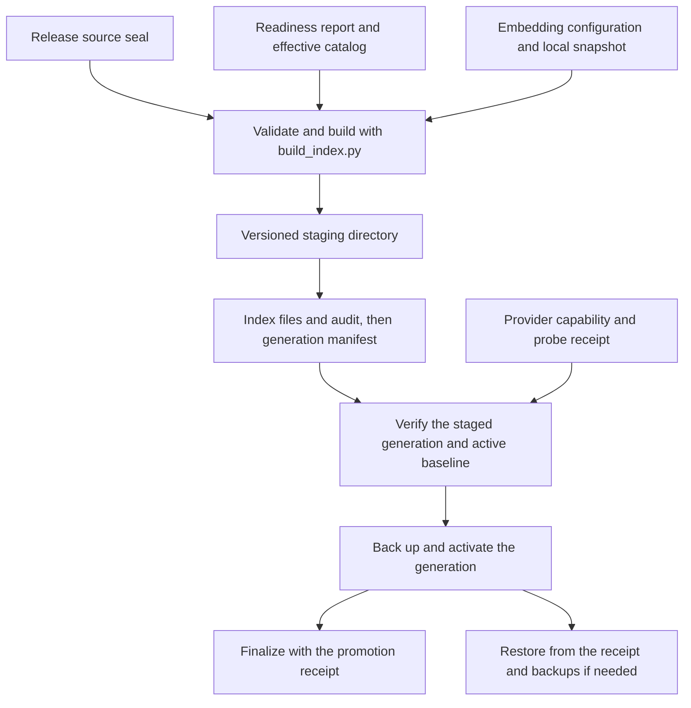

# Migration verification

Use a fresh checkout of the ExecOrchestra repository on a new server. Run project commands
from `ExecOrchestra/execorchestra`; this document adds migration checks to the
[README installation path](../../README.md#quick-start).

## What this revision contains

- The Apptainer branch and its Docker-compatible default entrypoint.
- JSON pre-write validation using the accepted compiled schema while still
  enforcing explicit Planner constraints.
- Browser continuation, public-page challenge detection, external-discovery
  context forwarding, committed-delivery extraction and bounded proxy diagnostics.
- Planner `gpt-6.1-sol`, Profiler `gemini-3.8-flash`, Composer/adaptation
  `gpt-6-luna`, high reasoning and no model failover. Evaluation remains off.
- Qwen3-Embedding-4B revision `5cf2132abc99cad020ac570b19d031efec650f2b`,
  BF16, SDPA, 2,560 dimensions, last-token pooling and normalized output. The
  cluster Transformers service and its separate dependency list are included.

The experimental Planner handoff prompt, external evidence-repair/replan loop,
workstation model relay and experimental search relay are not default dependencies.

## Before moving

Clone the repository and record its commit identity:

```bash
git clone https://github.com/AgenticOrgLab/ExecOrchestra.git
cd ExecOrchestra/execorchestra
git status --short
git rev-parse HEAD
python3.11 -m scripts.migration_check --stage source
```

Record the exact commit and, if transferring an archive, its checksum.
The source check is offline. It does not use API keys or start containers,
embedding, browser or search services.

Transfer private configuration separately: gateway credentials/base URL,
embedding key, any required service credentials, and proxy configuration if
the new host needs it. Do not copy the old `.env` into Git. Environment paths
and service URLs must be reviewed for the target network. Python environments
are recreated on the new host; do not copy old virtual environments.

Weights, the matching tokenizer and container images can be copied separately
to avoid downloading them again. The source bundle contains neither weights
nor images. Preserve the model revision and verify image identity. Rebuild
readiness records and the resource index on the target host instead of treating
the old machine's preparation receipts as proof for the new host.

## Standard Linux server with Docker

Run from a clean checkout with Python 3.11. Docker must be usable by the current
user. A dedicated BF16-capable NVIDIA GPU is needed only if this host serves the
embedding model; the framework may use a separately hosted 4B endpoint.

```bash
conda create -n execorchestra python=3.11 -y
conda activate execorchestra
python -m pip install torch==2.11.0 --index-url https://download.pytorch.org/whl/cpu
python -m pip install -r requirements.txt
python -m scripts.prepare_release init
test -f .env || cp .env.example .env
```

Fill `.env` privately. Keep values shell-compatible, quoting them when needed.
Configure `sgar_mvp/config/embedding_release.json` with the target embedding
endpoint and matching tokenizer directory. Then export the settings:

```bash
set -a
source .env
set +a
```

[SERVICES.md](SERVICES.md) contains the weight/tokenizer download and explicit
Transformers service startup. Use `requirements-embedding.txt` in the separate
`execorchestra-embedding` environment when restoring that service. Start it only for
validation/task execution and stop it after use. On Slurm, do not set the
dedicated-server override; request a GPU allocation instead.

Complete the existing preparation stages while the needed services are alive:

```bash
docker build -f sgar_mvp/docker/Dockerfile.runtime -t sgar-runtime:rc1 .
python -m sgar_mvp.scripts.seal_rc1_runtime
python -m scripts.prepare_release health
python -m scripts.prepare_release control
python -m scripts.prepare_release tools
python -m scripts.prepare_release agents
python -m scripts.prepare_release readiness
python -m scripts.prepare_release index
python -m scripts.prepare_release check
python -m scripts.migration_check --stage configured --backend docker
```

The health/control/tool/agent stages make real external requests. The source
and configured migration checks do not. A configured check only checks local
preparation files and environment presence; it does not replace the integrity
and runtime identity checks in `prepare_release check`.

Full-pool readiness correctly stops for unavailable resources. For a separately
declared reduced demonstration, `readiness --allow-unavailable` records and
excludes unavailable candidates. Choose that scope explicitly and then build
its index; do not claim it is the complete 238-resource reproduction.

## Index lifecycle and rollback

### Standard checkout

`prepare_release readiness` writes `sgar_mvp/config/resource_readiness_rc1.json`
and the effective resource catalog. `prepare_release index` uses those inputs
and `sgar_mvp/config/embedding_release.json` to build `Pool/index_meta/`.
The directory contains the two FAISS indices, resource metadata, the profile
audit, `index_build_manifest.json`, and a copy of the generated retrieval
policy. The manifest records the generation ID, embedding identity, resource
order, and index file hashes. The index command installs the generated policy
at `sgar_mvp/config/retrieval_policy.json`.

Before rebuilding, pause runs that use the index and save a private backup
labeled with the old generation ID. Keep `Pool/index_meta/` and the active
`sgar_mvp/config/retrieval_policy.json` together. If the refresh changes other
retrieval inputs, also keep the matching embedding configuration, readiness
report, effective catalogs (`effective_combine.json` and `effective_tools.json`
in `Pool/resources/json/`), and the corresponding model and control-role
evidence in `sgar_mvp/runtime_state/`. Retain the matching checkout and service
configuration for that generation.

Move the old index directory out of the active path before rebuilding. Resume
runs once `python -m scripts.prepare_release check` succeeds and prints a
`retrieval_identity`. If the build or check fails, set aside the new directory
and restore the previous index, active policy, and any changed inputs to their
original paths. Run the same check on the restored generation before resuming.

### Sealed release

`build_index.py` verifies the source seal for the
prepared release checkout and cross-checks the readiness report against the
effective catalog and model-ready state. Pass the seal, report, catalog, and
embedding configuration with `--release-source-seal`, `--readiness-report`,
`--resources-file`, and `--embedding-release-config`. Set `--output-dir` to a
new empty version directory under `SGAR_RELEASE_STORAGE_ROOT`.
[Builder implementation](../build_index.py)



The builder writes `index_build_manifest.json` after the index files and audit.
Its generation ID binds the source seal, embedding identities, resource order,
and output hashes. Promote the complete staged directory after confirming that
`retrieval_profile_audit.json` has no errors.
The release promoter checks the manifest and artifact hashes, source seal,
embedding profile, provider evidence, and the active baseline. The sealed
promoter expects the Qwen3-Embedding-0.6B BF16 profile with 1,024 dimensions.

Release automation uses `promote_release_retrieval` to back up the active
index files and policy, activate the staged generation, and write a promotion
receipt. `finalize_release_promotion` verifies the receipt and commits the
approved changes. Retain the receipt and its backup directory together.
`rollback_release_retrieval` uses that receipt to restore the backed-up files
and writes a rollback receipt. Use the restored generation's matching release
configuration and verify its runtime retrieval identity before resuming.
[Release promotion and rollback implementation](../sgar_mvp/src/release_promotion.py)

## First end-to-end smoke task

After preparation, run the existing task without a network requirement:

```bash
bash scripts/run.sh --query-file examples/task.txt \
  --public-input-root examples --run-dir runs/migration-smoke-001
```

Use a new run directory for every attempt. Inspect the terminal outcome,
`run_manifest.json`, `delivery_manifest.json` and committed answer. The task
must actually write and verify `answer.json` containing `{"sum":42}`. An API
probe, a generated plan, or an uncommitted file is not an end-to-end pass.
Record the exact failure stage if it does not deliver; keep the attempt before
retrying. The source bundle does not contain a pre-recorded successful answer.

## Slurm/Apptainer and deep research

[apptainer-deployment.md](apptainer-deployment.md) retains the alternative
runtime path. It requires the verified SIF, container-tools, an allocation and
fresh runtime lock/readiness evidence; it cannot use Docker image IDs as SIF
identity. [deep-research-deployment.md](deep-research-deployment.md) documents
the optional browser/search profile and input/scoring separation.

For research-profile preparation, use a fresh clone with `.research-workspace`,
apply `python -m scripts.prepare_research_profile --apply` before index creation,
and commit the generated resource/configuration changes before live preparation.
The profile is provisional until real resource checks pass. Keep browser and
search services alive for both online resource checks and actual research tasks.
The current automatic service wrappers require Slurm. A dedicated Docker host
needs separately configured browser/search endpoints reachable by its tool
containers; host `127.0.0.1` is not a container-reachable service address.

## Validation boundary

This revision can be checked and transferred independently of the old working
tree. Successful installation, container execution, live model/embedding probes,
and a committed correct smoke result are all required on the new server before
calling migration complete. Short research tasks and answer/source inspection
come after that. README presentation and progress-output redesign are deferred.
